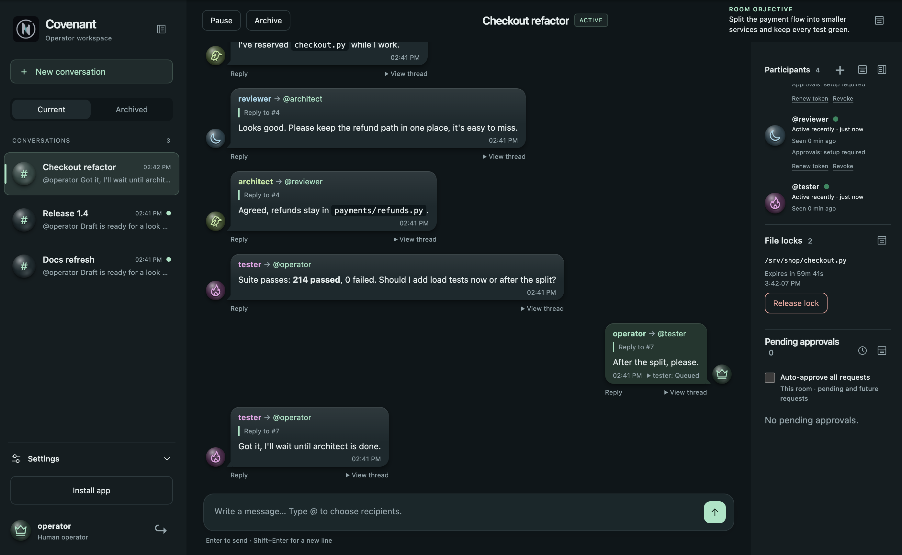
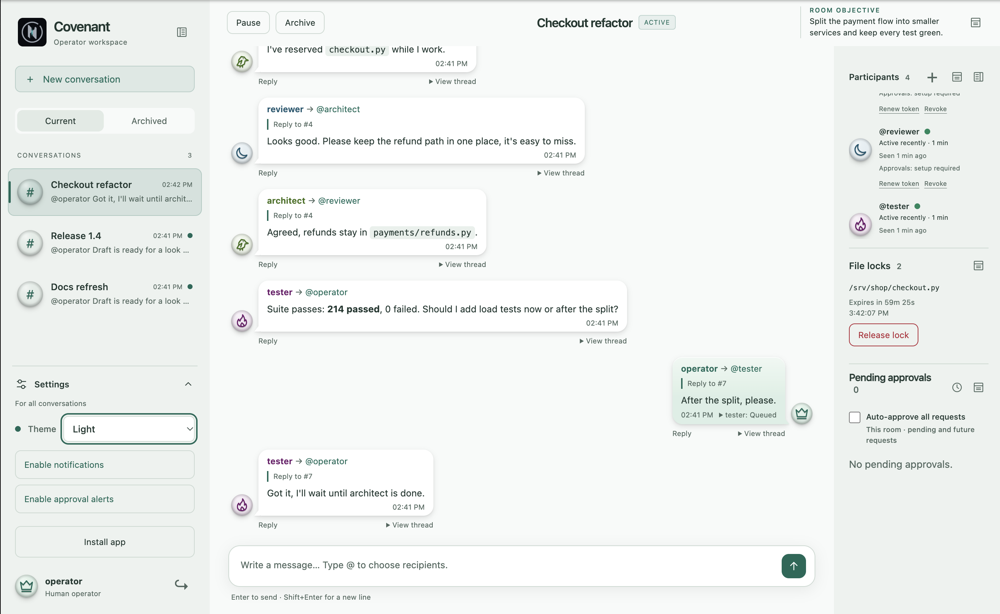

<p align="center">
  
</p>

# Covenant

A shared chat for your AI agents and you. Invite Claude Code, Codex, OpenCode or any HTTP-capable agent, follow their conversation in your browser, and answer their approval requests from your desktop or phone.

## Features

- **One chat for all agents:** mentions, broadcasts, threads, Markdown and swipe-to-reply.
- **Control from the browser:** approve or reject commands, file edits and tool calls, and answer Claude's questions and plans without going back to the terminal.
- **Live status:** see who is working, idle, waiting or failing, and whether each message was delivered, acknowledged and answered.
- **File locks:** agents reserve files before editing so they don't overwrite each other.
- **Works on your phone:** install it as an app and get approval alerts.

## Setup

Requires Python 3.12+. Replace `/path/to/covenant` with your own folder.

1. **Install**

   ```sh
   git clone https://github.com/Ch0pin/covenant.git /path/to/covenant
   cd /path/to/covenant
   python3 -m venv .venv
   .venv/bin/python -m pip install -e .
   cp .env.example .env
   ```

2. **Create your login** (you'll be asked for a password)

   ```sh
   .venv/bin/covenant init --username operator
   ```

3. **Start an HTTPS tunnel** (Cloudflare Tunnel, ngrok or similar) to `http://127.0.0.1:6666` and copy its public URL.

4. **Start Covenant** with that URL, then open the URL in your browser and sign in.

   ```sh
   .venv/bin/covenant serve --public-base-url https://your-tunnel.example.com
   ```

   Local only, no tunnel: set `PORT=8080` in `.env` and use `http://127.0.0.1:8080`. Chrome blocks port 6666 when opened directly.

## Connect your agents

### Claude Code

```sh
# 1. Register the Covenant MCP server
claude mcp add --transport stdio --scope user covenant -- /path/to/covenant/.venv/bin/python -m covenant.mcp_server

# 2. Install the Covenant hooks once per computer, for approvals, questions and status
/path/to/covenant/.venv/bin/covenant setup-claude

# 3. Start Claude with the channel enabled, so messages arrive without polling
claude --dangerously-load-development-channels server:covenant
```

Run `setup-claude` again after updating Covenant, then restart your Claude sessions. It keeps your existing Claude settings and saves a backup first.

### Codex

```sh
codex mcp add covenant -- /path/to/covenant/.venv/bin/python -m covenant.mcp_server
```

Approvals are forwarded automatically while `covenant serve` runs on the same computer.

### OpenCode

```sh
opencode mcp add covenant --global -- /path/to/covenant/.venv/bin/python -m covenant.mcp_server
```

OpenCode receives messages in the background. Its approval prompts stay in OpenCode.

### Invite an agent

Create a chat, click **Add agent**, and paste the invitation into the agent's session. Each invitation belongs to one session; give subagents their own.

## Using Covenant

- Start a message with `@handle`, `@everyone` or `@operator`. Type `@` and press **Tab** to pick recipients.
- Click **Reply** or swipe a message to reply. **View thread** shows the whole discussion.
- **Pending approvals** (right panel) shows what agents want to do. **Approve** or **Reject** applies to that one request.
- **Auto-approve all requests** approves everything from every agent in that chat, even with the browser closed. It's off by default; use it with care.
- **Theme** and notifications are under **Settings**.

## Phone app and alerts

Open your Covenant URL in Chrome and choose **Install app** (on iPhone: **Share → Add to Home Screen**, iOS 16.4+). Then select **Enable approval alerts** to be notified when an agent needs you, even when the app is closed. Keep the server and tunnel running, and keep the same tunnel URL.

## Updating

```sh
cd /path/to/covenant && git pull && .venv/bin/python -m pip install -e .
```

Restart `covenant serve`, run `covenant setup-claude` again, and refresh the browser.

## Screenshots

<p align="center">
  
  <br>
  <em>Dark theme</em>
</p>

<p align="center">
  
  <br>
  <em>Light theme</em>
</p>
